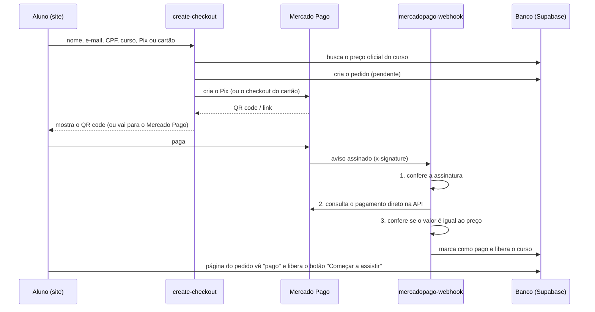

# Pagamentos e liberação dos cursos

Como o site recebe o dinheiro, confere se o pagamento é verdadeiro e libera o curso.
Hoje o site roda em **modo demonstração** (tudo simulado no navegador). Este guia leva
para o **modo real**: Supabase (banco, login e servidor) + Mercado Pago (Pix e cartão).

## Por que Mercado Pago

- **Pix na hora** com QR code dentro do próprio site e **cartão em até 12x** no checkout deles.
- Conta de pessoa física (CPF) funciona para começar; o dinheiro cai na conta do Mercado Pago no Brasil.
- Avisa o site automaticamente (webhook) quando o pagamento é aprovado, recusado ou devolvido.
- Os dados do cartão nunca passam pelo nosso site: quem digita e guarda é o Mercado Pago.

Alternativa sem programação: **Hotmart** ou **Kiwify** já fazem checkout, área de membros e
nota fiscal, cobrando uma taxa maior por venda. Dá para trocar depois sem refazer o visual:
basta apontar o botão "Comprar" para o link deles.

## Como funciona



As três conferências do aviso ficam registradas no pedido e aparecem na Área dos donos
(colunas **A**, **C** e **V**). Todo aviso recebido, válido ou não, fica salvo na tabela
`payment_events` para auditoria.

O que impede fraude:

| Tentativa | O que acontece |
|---|---|
| Alterar o preço no navegador | O servidor ignora: o valor vem da tabela `courses`. |
| Mandar um aviso falso de "pago" | A assinatura não bate e o aviso é recusado (401). |
| Pagar um valor menor | O valor não confere; o curso não é liberado e o pedido fica para conferência. |
| Ver o pedido de outra pessoa | Cada pedido tem um código secreto; sem ele, a consulta volta vazia. |
| Assistir sem comprar | O link do vídeo só sai do banco para quem tem matrícula ativa. |
| Pedir reembolso e continuar assistindo | O aviso de reembolso remove a matrícula na hora. |

## Passo a passo para ligar

### 1. Supabase

1. Crie um projeto em [supabase.com](https://supabase.com) (região São Paulo).
2. Instale a CLI (`npm i -g supabase`), entre (`supabase login`) e ligue a pasta:
   ```bash
   supabase link --project-ref SEU_PROJECT_REF
   supabase db push            # cria as tabelas, regras de segurança e funções
   ```
3. Em **Authentication → URL Configuration**, coloque o endereço do site em *Site URL* e
   adicione `https://SEU-SITE/?next=aluno` em *Redirect URLs* (é para onde o link de acesso leva).
4. Copie **Project URL** e **anon/publishable key** (Project Settings → API) para o arquivo
   `.env` (veja `.env.example`). Com isso o site sai do modo demonstração.

### 2. Mercado Pago

1. Em [Mercado Pago Developers](https://www.mercadopago.com.br/developers) → *Suas integrações*,
   crie uma aplicação (produto: pagamentos online / Checkout API).
2. Cadastre uma **chave Pix** na conta do Mercado Pago (sem ela o Pix não é gerado).
3. Copie o **Access Token** (comece pelas credenciais de teste).
4. Em **Webhooks**, cadastre a URL
   `https://SEU_PROJECT_REF.supabase.co/functions/v1/mercadopago-webhook`, marque o evento
   **Pagamentos** e copie a **assinatura secreta** gerada.

### 3. Segredos e funções

```bash
supabase secrets set \
  MP_ACCESS_TOKEN=APP_USR-... \
  MP_WEBHOOK_SECRET=... \
  SITE_URL=https://SEU-SITE
# opcional: e-mail de "curso liberado" pelo Resend
supabase secrets set RESEND_API_KEY=re_... EMAIL_FROM="Leo & Helena <oi@SEU-DOMINIO>"

supabase functions deploy create-checkout
supabase functions deploy mercadopago-webhook
```

### 4. Quem é dono

Entre uma vez na Área do aluno com o e-mail de vocês e rode no **SQL Editor**:

```sql
update auth.users
   set raw_app_meta_data = raw_app_meta_data || '{"role":"admin"}'
 where email in ('email-do-leo@...', 'email-da-helena@...');
```

Saia e entre de novo: o link **Área dos donos** (`#/admin`) passa a mostrar os pedidos.

### 5. Testar antes de vender

- Use o Access Token **de teste** e os cartões de teste do Mercado Pago.
- Faça uma compra no Pix e outra no cartão, confira se o pedido muda para **Pago** sozinho e
  se o curso aparece na Área do aluno.
- Na tabela `payment_events`, todos os avisos devem estar com `signature_valid = true`.
- Troque para o Access Token **de produção** e repita uma compra real de valor baixo.

## Onde está cada parte

| Arquivo | O que faz |
|---|---|
| `supabase/migrations/…_cursos_pagamentos.sql` | Tabelas, regras de segurança e funções do banco |
| `supabase/functions/create-checkout` | Cria o pedido e o Pix/checkout no Mercado Pago |
| `supabase/functions/mercadopago-webhook` | Recebe o aviso, confere e libera o curso |
| `supabase/functions/_shared/mercadopago.ts` | Chamada à API e verificação da assinatura (com testes) |
| `src/lib/payments/` | Lado do site: modo demonstração e modo real |
| `src/pages/Checkout.tsx`, `Order.tsx` | Telas de compra e de acompanhamento do pagamento |
| `src/pages/admin/Admin.tsx` | Área dos donos: pedidos, verificação e confirmação manual |

Testes da assinatura: `deno test supabase/functions/_shared/mercadopago.test.ts`.

## Ainda falta (próximos passos)

- **Vídeos das aulas**: subir as gravações (Bunny Stream, Vimeo ou YouTube não listado) e
  preencher a tabela `lessons` com o link de cada aula.
- **Nota fiscal e impostos**: para vender com frequência, vale abrir MEI/CNPJ. Como vocês moram
  na Irlanda, confirmem com um contador onde declarar essa renda.
- **Reembolso pelo site**: hoje é feito no painel do Mercado Pago (o site já remove o acesso
  sozinho quando recebe o aviso).
